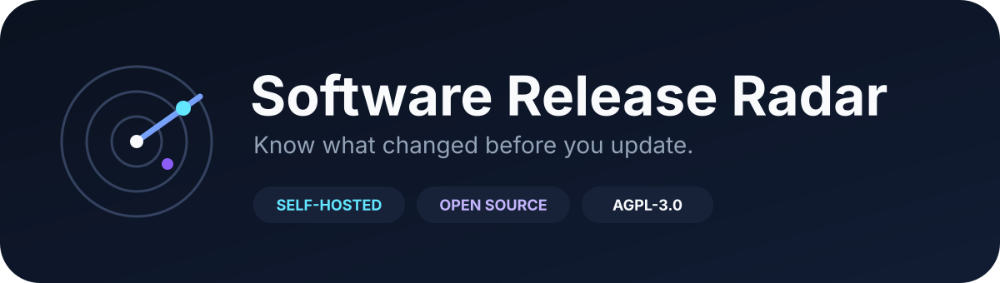
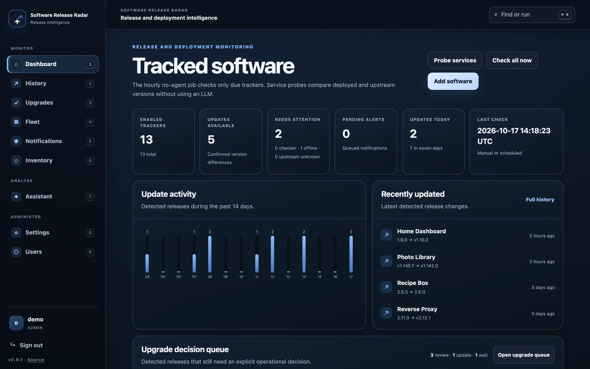
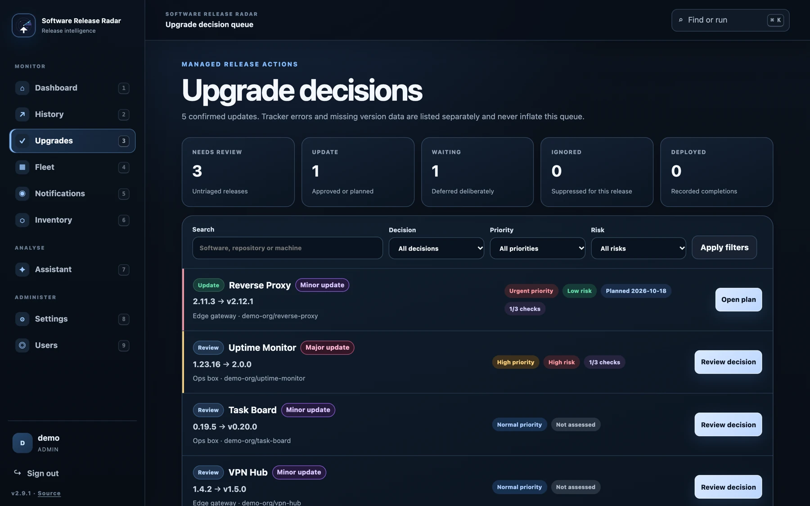
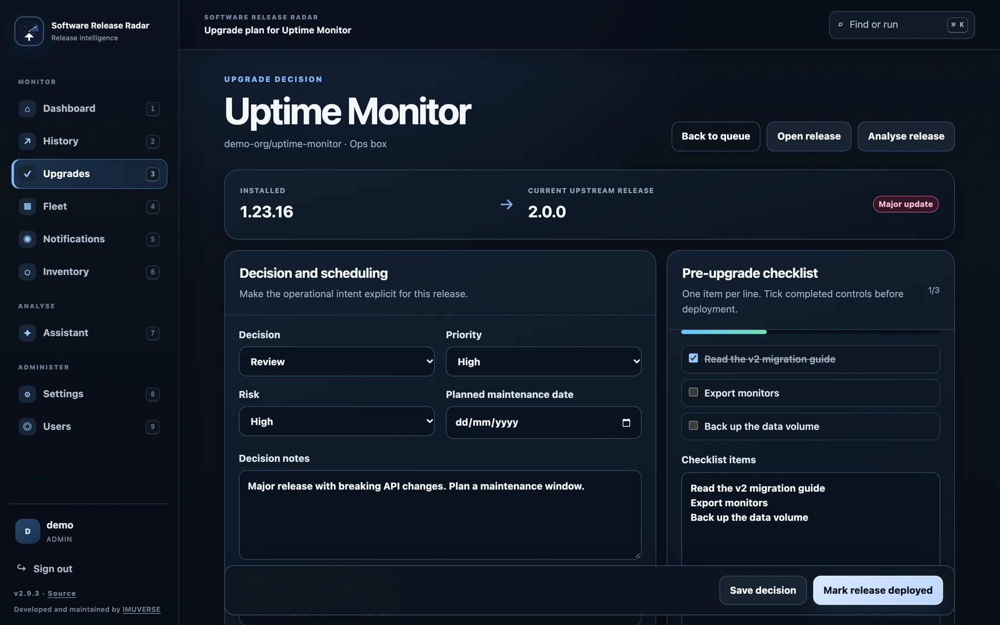
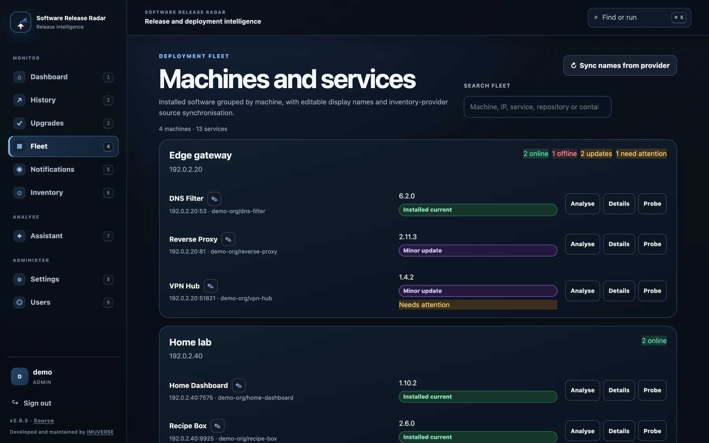

<p align="center">
  
</p>

<p align="center">
  <a href="https://github.com/muhdusama/Software-Release-Radar/releases/latest"></a>
  <a href="https://github.com/muhdusama/Software-Release-Radar/actions/workflows/ci.yml"></a>
  
  
  <a href="LICENSE"></a>
  
</p>

<p align="center">Developed and maintained by <a href="https://imuverse.com"><strong>IMUVERSE</strong></a></p>

<p align="center">
  <a href="#quick-start">Quick start</a> ·
  <a href="#why-release-radar">Why Release Radar?</a> ·
  <a href="#preview">Preview</a> ·
  <a href="docs/COMPARISON.md">Comparison</a> ·
  <a href="CHANGELOG.md">Revision updates</a> ·
  <a href="ROADMAP.md">Roadmap</a> ·
  <a href="#documentation">Documentation</a>
</p>

# Software Release Radar

**Understand what you gain, what might break and what you miss by waiting, before you update.**

Software Release Radar is a self-hosted dashboard for reviewing software updates across a homelab or small server fleet. It tracks upstream GitHub releases against the versions you actually run, adds service and container context, and keeps your upgrade decisions in one place.

**Version 2.10.3** adds revision filtering, a clearer comparison page and visible contributor credits with an AI development and maintenance disclosure. See the [changelog](CHANGELOG.md) for changes and compatibility notes.

## Why Release Radar?

Knowing that an update exists is the start of the decision. You still need to understand its value and cost:

- **What will I gain?** Features, fixes and improvements documented since the installed version.
- **What could I lose?** Removed functionality, deprecated settings and changed behaviour described upstream.
- **What do I miss if I wait?** Improvements and fixes that remain unavailable on the current version.
- **What needs preparation?** Compatibility checks, migrations, a maintenance window and a rollback plan.

Release Radar connects that review to your installed versions, fleet inventory and an explicit **Update, Wait, Ignore or Needs Attention** decision. The optional Release Assistant interprets the evidence; you retain control of deployment.

### Analyse before replacing a container image

For inventory-linked services, Release Radar can bring the recorded running image reference, available digest, detected version and state into a release comparison. It reads the available GitHub release notes between the installed version and tracked target, then asks the Assistant to explain benefits, removals, the cost of waiting and evidence gaps.

**This is release and inventory analysis, not a candidate-image security scan.** Release Radar does not yet pull or inspect a proposed image, resolve registry digests, compare SBOMs, verify signatures or test the new container. It cannot guarantee compatibility from release notes. Exact image preflight is the first major item on the [roadmap](ROADMAP.md).

### How it differs from other tools

Diun, What's Up Docker, Renovate and Trivy are excellent projects, and we encourage you to explore them. We value their contributions to the community and see them as useful companions in a software maintenance workflow.

Release Radar's distinctive focus is the upgrade decision for the software you run: what you gain, what may be removed, what you miss by waiting, and how you plan and record the change.

| Tool | Main job | Where Release Radar fits |
|---|---|---|
| [Diun](https://crazymax.dev/diun/) | Detect image tag or digest changes and notify | Review application release changes and record the operational decision |
| [What's Up Docker](https://getwud.app/) | Monitor container updates and run notification or update triggers | Plan benefits, risks, timing and rollback before deployment |
| [Renovate](https://docs.renovatebot.com/docker/) | Propose dependency, image tag and digest changes in Git | Add context from running services and a fleet-wide upgrade review |
| [Trivy](https://trivy.dev/docs/latest/target/container_image/) | Inspect images for security findings and work with SBOMs | Review application changes; use Trivy separately for image security evidence |

These tools have overlapping and complementary roles. See the [comparison guide](docs/COMPARISON.md) for details, sources and current limitations. Release Radar does not apply updates or replace your deployment tools.

## Quick start

Requirements: Docker Engine or Docker Desktop, Docker Compose v2 or later, and Git.

```bash
git clone https://github.com/muhdusama/Software-Release-Radar.git
cd Software-Release-Radar
bash scripts/setup.sh
```

Open **http://localhost:9120**.

The setup helper asks for the first administrator account, generates application secrets in a temporary container, writes a protected `.env`, builds the stack and waits for health. It does not save the administrator password itself. Host Python is not required.

Published images are available at `ghcr.io/muhdusama/software-release-radar` for `linux/amd64` and `linux/arm64`. To use one, follow [the published-image deployment instructions](docs/DOCKER.md#use-the-published-image-instead-of-building).

Read the [Docker guide](docs/DOCKER.md) and [security hardening guide](docs/SECURITY-HARDENING.md) before exposing the application outside a trusted network.

## Preview

Screenshots below show v2.9.3 using fictional demo data and documentation-reserved addresses. They illustrate the existing core workflow; the 2.10.0 project pages are described in the [changelog](CHANGELOG.md).

### Dashboard

Tracked software, installed and upstream versions, update counts and recent release activity.



### Upgrade decisions

A review queue with priority, risk and maintenance planning.



### Upgrade plan

A recorded decision, checklist and rollback context for a specific release.



### Fleet

Services grouped by machine, with health and update status.



## Capabilities

| Area | Available now |
|---|---|
| Release tracking | GitHub releases, prereleases and latest tags; refresh interval per tracker |
| Version awareness | Manual versions, service probes, constrained SSH Docker inspection and inventory-provider detection |
| Fleet inventory | Portainer or Dockhand, machine and service context, aliases and container rebinding |
| Upgrade review | Decisions, priorities, risk, maintenance dates, checklists, rollback notes and deployment records |
| Optional Assistant | Release comparison and tracker chat using an OpenAI-compatible endpoint |
| Notifications | SMTP email and Pushover with system, user, channel and software preferences |
| Project information | About, Revision updates and Roadmap pages inside the application |
| Access and storage | Administrator and standard-user roles, SQLite WAL storage and encrypted integration secrets |
| Deployment | Docker Compose, persistent state and published multi-architecture images |

### Monitoring without AI

The standard stack runs three services: the web application, scheduler and inventory worker. The scheduler wakes every 60 seconds by default and checks only trackers whose own refresh interval is due. No external cron job or LLM is needed for release checks, version comparison, health probes or standard notifications.

### Optional release analysis

Configure an OpenAI-compatible endpoint in Settings to use the Assistant. It receives selected tracker, deployment and release-note context, so choose a provider appropriate for your data. Model output is advisory, escaped for display and bounded by request controls.

Release history currently uses the latest 20 GitHub release records returned by the API, filtered for the tracker's prerelease setting. Missing version boundaries and truncated notes are identified as incomplete. Tag-only tracking does not provide a complete historical release comparison.

### Upgrade and recovery

Read the [revision updates](CHANGELOG.md) before upgrading. Version 2.10.3 requires no database migration or new configuration. Preserve your `.env`, data and SSH material, and retain a rollback image.

The repository includes online SQLite backup and guarded restore helpers:

```bash
./scripts/backup.sh
bash scripts/restore.sh ./backups/radar-YYYYMMDD-HHMMSS.db --confirm
```

The [Docker guide](docs/DOCKER.md) explains their operation and the difference between restoring application state and reverting an image. Use your established host backup process as well.

## Quality and security

Pull requests run Python 3.13 tests, dependency vulnerability auditing, a reviewed Bandit gate and Docker setup/recovery acceptance. The [Actions page](https://github.com/muhdusama/Software-Release-Radar/actions) records the result for each revision. A passing historical run is not a guarantee for a later build or a particular deployment.

The application includes CSRF protection, authenticated access, login/reset throttling, encrypted integration credentials, a non-root container user and a Content Security Policy that blocks inline scripts. Credential-bearing integration requests require HTTPS by default and use constrained redirects and response sizes. Optional SSH probes use fixed commands and strict host-key checking.

Report vulnerabilities through [SECURITY.md](SECURITY.md), not a public issue. The [October repository review](docs/REPOSITORY-REVIEW.md) records addressed gaps and the highest-value remaining work.

## Roadmap and contributions

The next priorities are exact candidate-image preflight, reproducible release comparisons and clearer operational evidence. Scanner integrations, more release sources and a read-only API remain future work. The [roadmap](ROADMAP.md) separates shipped capabilities from proposed additions and gives acceptance criteria for the next priorities.

Use [Issues](https://github.com/muhdusama/Software-Release-Radar/issues) for reproducible bugs and feature requests, and [Discussions](https://github.com/muhdusama/Software-Release-Radar/discussions) for questions and proposals. See [CONTRIBUTING.md](CONTRIBUTING.md) and [feature voting](FEATURE_VOTING.md).

## People and development

Created and maintained by [@muhdusama](https://github.com/muhdusama) under [IMUVERSE](https://imuverse.com), with human contributions including Dockhand compatibility from [@KoshiirRa](https://github.com/KoshiirRa).

See the [Contributors page](CONTRIBUTORS.md) for visible credits, including [OpenAI Codex (@codex)](https://github.com/codex), Claude Code and community contributions. The application also includes a Contributors page under Project.

## AI-assisted development and maintenance

AI was used to assist in the development and maintenance of Software Release Radar. OpenAI Codex and Anthropic Claude Code have helped with implementation, debugging, tests, security review assistance, documentation and release preparation.

The maintainer directs the work, reviews changes, verifies behaviour and decides what is accepted and deployed. AI assistance does not replace human responsibility. This disclosure is separate from the optional in-app Release Assistant: core monitoring and notifications work without an LLM.

## Documentation

| Guide | Purpose |
|---|---|
| [Docker deployment](docs/DOCKER.md) | Install, upgrade, back up, restore and troubleshoot |
| [Configuration](docs/CONFIGURATION.md) | Environment variables and optional integrations |
| [Comparison](docs/COMPARISON.md) | Why Release Radar, other tools and analysis limits |
| [Revision updates](CHANGELOG.md) | Versioned application changes and compatibility notes |
| [Roadmap](ROADMAP.md) | Shipped features, priorities and future acceptance criteria |
| [Repository review](docs/REPOSITORY-REVIEW.md) | Gaps addressed and remaining opportunities |
| [Notifications](docs/NOTIFICATIONS.md) | Global, personal and per-software alert controls |
| [Architecture](docs/ARCHITECTURE.md) | Runtime services and design boundaries |
| [Security hardening](docs/SECURITY-HARDENING.md) | Deployment protections |
| [GitHub workflow](docs/GITHUB-WORKFLOW.md) | Review, CI, releases and deployment provenance |

## Licence and support

Licensed under [GNU AGPL-3.0](LICENSE). See [COMMERCIAL_USE.md](COMMERCIAL_USE.md) for commercial-use guidance and source-sharing obligations.

If the project is useful to you, optional support is available through [Buy Me a Coffee](https://buymeacoffee.com/muhdusama) or [PayPal](https://www.paypal.com/paypalme/muhdusama). See [SUPPORT.md](SUPPORT.md).
